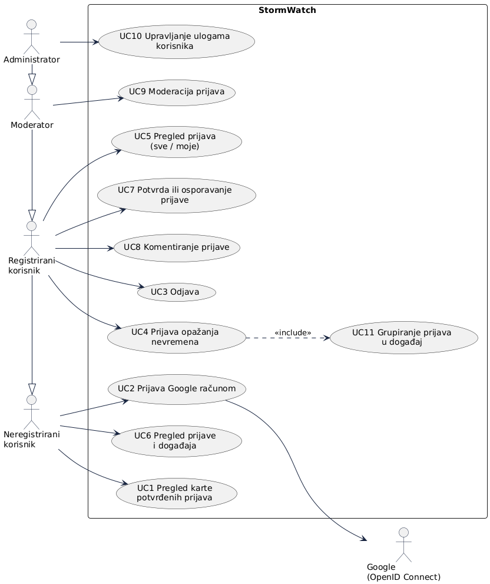

# 3. Obrasci uporabe

## 3.1 Dijagram obrazaca uporabe

Generalizacija aktera: registrirani korisnik nasljeđuje ovlasti neregistriranog, moderator registriranog, administrator moderatora. Google je vanjski sustav koji potvrđuje identitet.

## 3.2 Specifikacije obrazaca uporabe

### UC1 – Pregled karte potvrđenih prijava

| **Polje** | **Opis** |
|---|---|
| Primarni akter | Neregistrirani ili registrirani korisnik. |
| ID zahtjeva | TBD |
| Preduvjeti, ako postoje | --- |
| Glavni tijek | 1. Korisnik otvara početnu stranicu. 2. Sustav prikazuje kartu (OpenStreetMap) i potvrđene prijave iz posljednjih 7 dana. 3. Korisnik mijenja filtre vrste pojave i razdoblja (24 sata, 7 dana, 30 dana ili godina). 4. Sustav ponovno dohvaća prijave. 5. Klikom na oznaku korisnik otvara sažetak i poveznicu na prijavu. |
| Alternativni ili neuspješni tijekovi, ako postoje | --- |
| Rezultat | Korisnik vidi kartu potvrđenih prijava nevremena. Karta se automatski osvježava svakih 20 sekundi. |

### UC2 – Prijava Google računom

| **Polje** | **Opis** |
|---|---|
| Primarni akter | Neregistrirani korisnik. |
| Sekundarni akter | Google. |
| ID zahtjeva | TBD |
| Preduvjeti, ako postoje | Korisnik ima Google račun. |
| Glavni tijek | 1. Korisnik bira opciju „Prijavi se s Googleom”. 2. Sustav preusmjerava korisnika na Google uz parametre `client_id`, `scope` i `state`. 3. Korisnik se prijavljuje i odobrava pristup. 4. Google vraća korisnika s autorizacijskim kodom (`code`). 5. Sustav zamjenjuje kod za tokene i dohvaća profil. 6. Sustav stvara ili ažurira korisnika prema identifikatoru `google_sub`. 7. Sustav započinje korisničku sesiju. |
| Alternativni ili neuspješni tijekovi, ako postoje | Korisnik odbije pristup ili parametar `state` nije ispravan. Sustav vraća korisnika na stranicu za prijavu. |
| Rezultat | Korisnik je prijavljen u aplikaciju. Pri prvoj prijavi nastaje račun s ulogom `user`, odnosno `admin` ako se njegova adresa e-pošte nalazi u admin e-mail adresama. |

### UC3 – Odjava

| **Polje** | **Opis** |
|---|---|
| Primarni akter | Prijavljeni korisnik. |
| ID zahtjeva | UC3 |
| Preduvjeti, ako postoje | Korisnik je prijavljen u aplikaciju. |
| Glavni tijek | 1. Korisnik odabire opciju „Odjava”. 2. Sustav završava korisničku sesiju. 3. Sustav preusmjerava korisnika na početnu stranicu. |
| Alternativni ili neuspješni tijekovi, ako postoje | Ako je korisnička sesija već istekla, sustav korisnika preusmjerava na početnu stranicu kao neprijavljenog korisnika. |
| Rezultat | Korisnik je uspješno odjavljen iz aplikacije. |

### UC4 – Prijava opažanja nevremena

| **Polje** | **Opis** |
|---|---|
| Primarni akter | Registrirani korisnik. |
| ID zahtjeva | TBD |
| Preduvjeti, ako postoje | Korisnik je prijavljen u aplikaciju. |
| Glavni tijek | 1. Korisnik otvara obrazac za prijavu opažanja nevremena. 2. Bira vrstu pojave, a za tuču i veličinu zrna. 3. Označava lokaciju na karti ili koristi GPS. 4. Unosi vrijeme opažanja, mjesto, procjenu štete i opis. 5. Sustav provjerava unesene podatke. 6. Sustav pridružuje prijavu događaju prema UC11. 7. Sustav sprema prijavu. 8. Status prijave postaje `na čekanju`, odnosno `potvrđena` ako je autor pouzdan motritelj, moderator, meteorolog ili administrator. |
| Alternativni ili neuspješni tijekovi, ako postoje | Ako su podaci neispravni (lokacija izvan Hrvatske, vrijeme u budućnosti ili starije od 30 dana, tuča bez veličine zrna ili predug opis), sustav vraća obrazac s porukama o pogreškama. |
| Rezultat | Prijava opažanja nevremena spremljena je u sustav, pridružena odgovarajućem događaju i dodijeljen joj je status `na čekanju` ili `potvrđena`. |

### UC5 – Pregled prijava

| **Polje** | **Opis** |
|---|---|
| Primarni akter | Prijavljeni korisnik. |
| ID zahtjeva | TBD |
| Preduvjeti, ako postoje | Korisnik je prijavljen u aplikaciju. |
| Glavni tijek | 1. Korisnik otvara stranicu „Prijave”. 2. Bira opciju „Sve prijave” ili „Moje prijave”. 3. Sustav dohvaća prijave prema odabranom prikazu. 4. Sustav prikazuje popis prijava. Svaka stavka prikazuje vrstu pojave, mjesto, vrijeme, autora, status i ocjenu vjerodostojnosti. |
| Alternativni ili neuspješni tijekovi, ako postoje | Ako korisnik odabere „Sve prijave”, sustav prikazuje sve prijave osim odbijenih. Ako odabere „Moje prijave”, sustav prikazuje njegove prijave, uključujući odbijene. |
| Rezultat | Korisnik pregledava popis prijava i njihove osnovne podatke u skladu s odabranim prikazom. |

### UC6 – Pregled prijave i događaja

| **Polje** | **Opis** |
|---|---|
| Primarni akter | Registrirani ili neregistrirani korisnik. |
| ID zahtjeva | TBD |
| Preduvjeti, ako postoje | Prijava ili događaj postoji u sustavu. Korisnik mora imati odgovarajuća prava za pregled sadržaja s ograničenim pristupom. |
| Glavni tijek | 1. Korisnik otvara odabranu prijavu ili događaj. 2. Sustav provjerava korisnikova prava pristupa. 3. Sustav prikazuje detalje prijave, ocjenu vjerodostojnosti, komentare i poveznicu na događaj. 4. Korisnik pregledava prikazane informacije. |
| Alternativni ili neuspješni tijekovi, ako postoje | Neregistrirani korisnici vide samo potvrđene prijave. Odbijenu prijavu mogu vidjeti njezin autor, moderatori i administratori, uz prikaz razloga odbijanja. Korisnicima bez odgovarajućih prava pristup nije omogućen. |
| Rezultat | Korisniku su prikazani detalji prijave i povezanog događaja u skladu s njegovim pravima pristupa. |

### UC7 – Potvrda ili osporavanje prijave

| **Polje** | **Opis** |
|---|---|
| Primarni akter | Registrirani korisnik. |
| ID zahtjeva | TBD |
| Preduvjeti, ako postoje | Prijava nije odbijena, a korisnik nije njezin autor. |
| Glavni tijek | 1. Korisnik otvara prijavu. 2. Odabire opciju „I ja to vidim” ili „Kod mene nije tako”. 3. Sustav sprema korisnikov glas. 4. Sustav provjerava postoji li već glas tog korisnika za prijavu. 5. Ako glas postoji, sustav ažurira postojeći glas. 6. Sustav ponovno izračunava ocjenu vjerodostojnosti. 7. Sustav prikazuje novu ocjenu korisniku. |
| Alternativni ili neuspješni tijekovi, ako postoje | Korisnik ne može glasati za vlastitu prijavu niti za prijavu koja je odbijena. Ako promijeni prethodni glas, sustav ažurira postojeći glas umjesto stvaranja novog. |
| Rezultat | Korisnikov glas je spremljen ili ažuriran, a ocjena vjerodostojnosti prijave ponovno je izračunata. |

### UC8 – Komentiranje prijave

| **Polje** | **Opis** |
|---|---|
| Primarni akter | Prijavljeni korisnik. |
| ID zahtjeva | TBD |
| Preduvjeti, ako postoje | Korisnik je prijavljen u aplikaciju i ima pristup odabranoj prijavi. |
| Glavni tijek | 1. Korisnik otvara stranicu odabrane prijave. 2. Unosi tekst komentara. 3. Objavljuje komentar. 4. Sustav provjerava duljinu komentara. 5. Sustav sprema komentar i prikazuje ga na stranici prijave. |
| Alternativni ili neuspješni tijekovi, ako postoje | Ako komentar sadrži manje od 1 ili više od 500 znakova, sustav ga ne prihvaća. |
| Rezultat | Komentar duljine od 1 do 500 znakova uspješno je spremljen i prikazan na stranici prijave. |

### UC9 – Moderacija prijava

| **Polje** | **Opis** |
|---|---|
| Primarni akter | Moderator. |
| Sekundarni akter | Administrator. |
| ID zahtjeva | TBD |
| Preduvjeti, ako postoje | Korisnik ima ulogu moderatora ili administratora. U sustavu postoje prijave koje čekaju moderaciju. |
| Glavni tijek | 1. Moderator otvara stranicu „Moderacija”. 2. Sustav prikazuje prijave na čekanju. 3. Moderator odabire prijavu. 4. Moderator odlučuje hoće li prijavu potvrditi ili odbiti. 5. Ako potvrdi prijavu, sustav mijenja njezin status u `potvrđena` i autoru dodjeljuje 10 bodova. 6. Ako odbije prijavu, moderator unosi obavezno obrazloženje, sustav mijenja status u `odbijena` i autoru smanjuje kredibilitet. |
| Alternativni ili neuspješni tijekovi, ako postoje | Ako moderator pokuša odbiti prijavu bez obrazloženja, sustav ne dopušta dovršetak odbijanja. |
| Rezultat | Prijava je potvrđena ili odbijena, a reputacija autora je ažurirana. U prvoj inačici moderator vidi prijave svih regija. |

### UC10 – Upravljanje ulogama korisnika

| **Polje** | **Opis** |
|---|---|
| Primarni akter | Administrator. |
| ID zahtjeva | TBD |
| Preduvjeti, ako postoje | Administrator je prijavljen u aplikaciju i ima odgovarajuća administratorska prava. |
| Glavni tijek | 1. Administrator otvara stranicu „Administracija”. 2. Sustav prikazuje popis korisnika. 3. Administrator odabire korisnika kojem želi promijeniti ulogu. 4. Sustav prikazuje korisnikovu reputaciju i oznaku kandidata za pouzdanog motritelja ako ima određenu količinu reputacije. 5. Administrator odabire novu ulogu korisnika. 6. Sustav sprema promjenu uloge. |
| Alternativni ili neuspješni tijekovi, ako postoje | Administrator ne može promijeniti vlastitu ulogu. Korisnik s najmanje 50 bodova označava se kao kandidat za pouzdanog motritelja. |
| Rezultat | Uloga odabranog korisnika uspješno je promijenjena, a njegova reputacija i status kandidata za pouzdanog motritelja prikazani su administratoru. |

### UC11 – Grupiranje prijava u događaj

| **Polje** | **Opis** |
|---|---|
| Primarni akter | Sustav aplikacije. |
| ID zahtjeva | TBD |
| Pokretač procesa | Zaprimanje nove prijave opažanja nevremena prema UC4. |
| Preduvjeti, ako postoje | Nova prijava sadrži vrstu pojave, lokaciju i vremenski raspon opažanja. |
| Glavni tijek | 1. Sustav zaprima novu prijavu. 2. Traži postojeće događaje iste vrste pojave. 3. Provjerava nalazi li se postojeći događaj unutar 15 km i 3 sata od vremenskog raspona nove prijave. 4. Ako postoji više odgovarajućih događaja, odabire najbliži. 5. Pridružuje novu prijavu odabranom događaju. 6. Ako ne postoji odgovarajući događaj, stvara novi događaj. 7. Dodjeljuje naslov događaju prema vrsti pojave, mjestu i datumu, primjerice „Tuča, Đakovo, 14. 7. 2026.” |
| Alternativni ili neuspješni tijekovi, ako postoje | Ako ne postoji događaj iste vrste pojave koji zadovoljava prostorni kriterij od 15 km i vremenski kriterij od 3 sata, sustav stvara novi događaj umjesto pridruživanja postojećem. |
| Rezultat | Nova prijava pridružena je najbližem odgovarajućem događaju ili je stvoren novi događaj s odgovarajućim naslovom. |

---

## 3.3 Provjera dosljednosti obrazaca uporabe

| **Provjera** | **Rezultat provjere** |
|---|---|
| Zahtjevi | Svaki obrazac uporabe povezan je s odgovarajućim funkcijskim zahtjevom. |
| Akteri | Akteri odgovaraju definiranim ulogama korisnika i njihovim ovlastima. |
| Aplikacija | Glavni i alternativni tijekovi mogu se provjeriti odgovarajućim ispitnim slučajevima. |

**Uočene nedosljednosti:**

- Potrebno je razlikovati kandidata za pouzdanog motritelja od korisnika koji već ima taj status.
- Potrebno je dodatno uskladiti pravila vidljivosti prijava i izračun ocjene vjerodostojnosti.
- Kod UC11 potrebno je jasno definirati prostorne i vremenske kriterije grupiranja prijava.

UC11 je automatizirani proces koji izvršava sustav, stoga ne zahtijeva ljudskog aktera.
