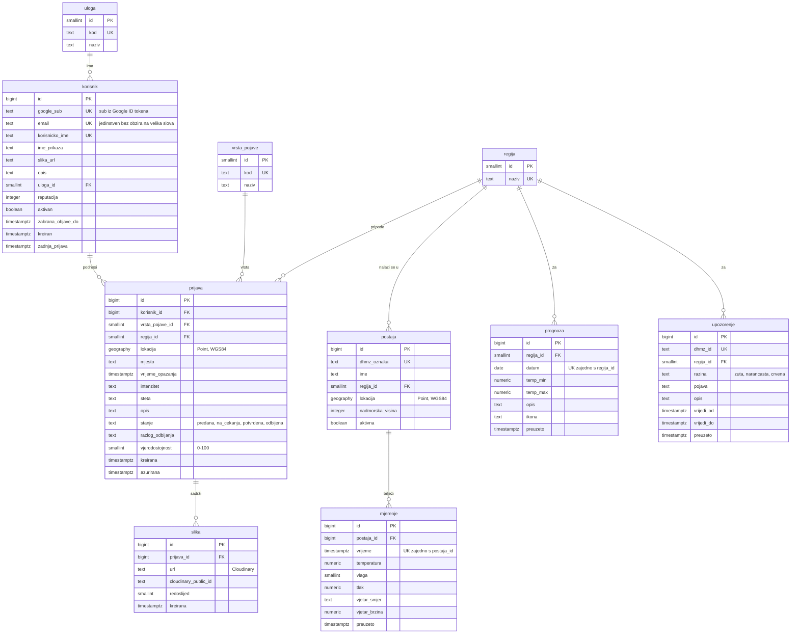
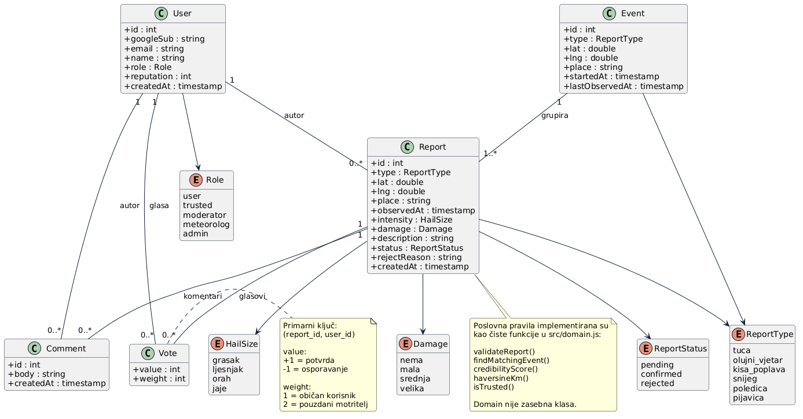
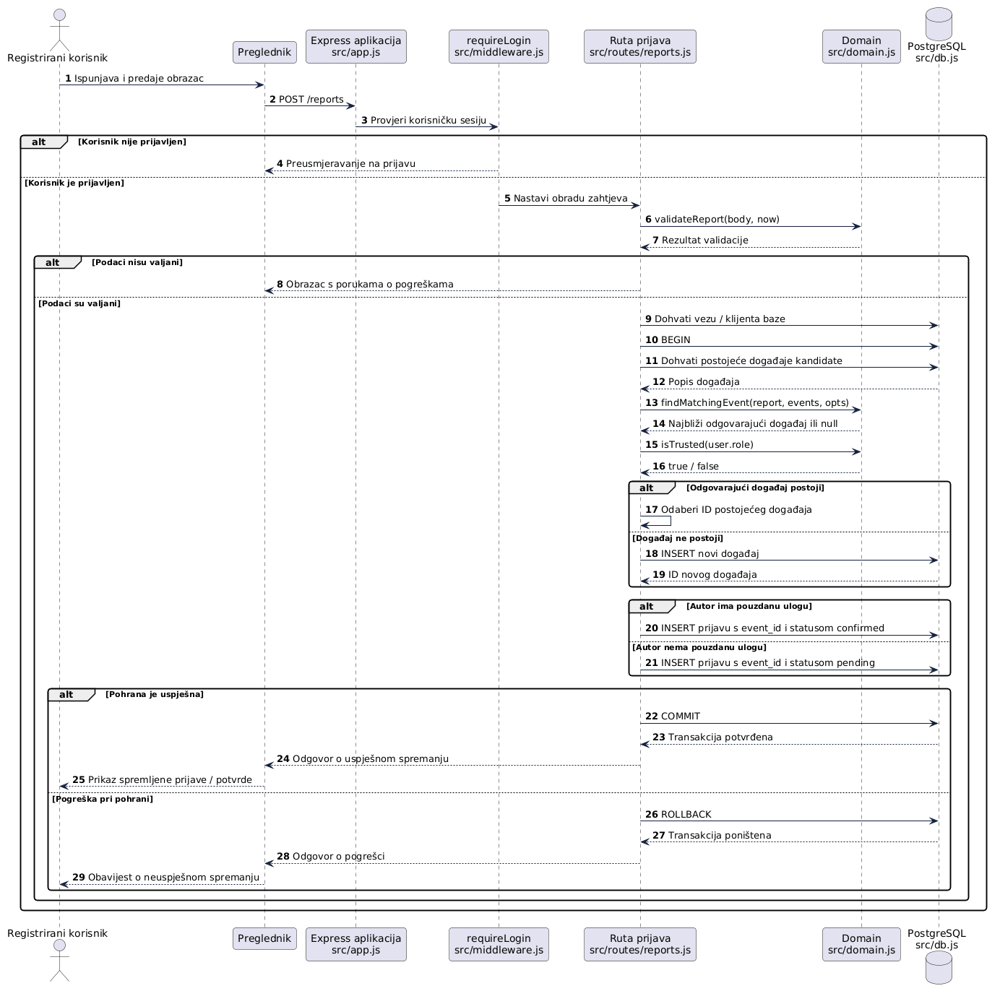
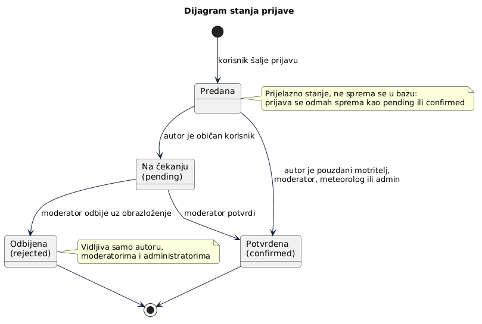

# 4. Arhitektura i oblikovanje

| Arhitekturni pogled | Ključno inženjersko pitanje | Primijenjeni model ili dijagram |
|---|---|---|
| Strategija rješenja | Koji stil i odluke određuju aplikaciju? | Arhitekturne odluke i MVC slojevi (4.1) |
| Struktura podsustava | Koji su glavni dijelovi i kako komuniciraju? | Dijagram komponenata (4.2) |
| Model podataka | Kako su organizirani trajni podaci? | ER dijagram i opis tablica (4.3.1) |
| Struktura koda | Gdje se nalaze poslovna pravila i odgovornosti? | Dijagram razreda / domenskih entiteta (4.3.2) |
| Dinamičko ponašanje | Kako se obrađuju ključni scenariji? | Sekvencijski i dijagram aktivnosti (4.4.1) |
| Stanja sustava | Kako se mijenja status prijave? | Dijagram stanja (4.4.2) |
| Fizički razmještaj | Gdje se izvode aplikacija i baza? | Dijagram razmještaja (4.2) |

## 4.1 Ključne arhitekturne odluke

StormWatch je **monolitna web-aplikacija** s poslužiteljskim generiranjem HTML-a (*server-side rendering*). Jedan Node.js/Express proces poslužuje EJS stranice, statičke datoteke i JSON endpoint za kartu, a trajni podaci pohranjuju se u PostgreSQL bazu. Arhitektura je slojevita prema načelu MVC-a.

| Odluka | Razmatrana alternativa | Projektno specifično obrazloženje i kompromis |
|---|---|---|
| Monolitna web-aplikacija u jednom Node.js/Express procesu | Više zasebno postavljenih servisa | Jedan proces jednostavniji je za razvoj, postavljanje i ispitivanje u okviru prve inačice i iskustva tima. Kompromis je to što kvar procesa može učiniti nedostupnima sve funkcionalnosti aplikacije. |
| Poslužiteljsko generiranje stranica putem EJS-a uz JSON endpoint za kartu | Zasebna SPA aplikacija i neovisni API | EJS omogućuje posluživanje stranica iz istog procesa, dok JSON endpoint podržava dohvat podataka za kartu. Time se izbjegava dodatna zasebna klijentska aplikacija, ali se dio prikaza i dalje oslanja na poslužiteljske predloške. |
| Relacijska baza PostgreSQL | Dokumentno orijentirana pohrana | Korisnici, prijave, događaji, glasovi i komentari imaju jasne međusobne veze. Relacijska baza omogućuje njihovo dosljedno povezivanje i ograničenja, uz potrebu za održavanjem sheme. |
| Poslovna pravila izdvojena u čiste funkcije modula `domain.js` | Smještanje pravila izravno u HTTP rute ili upite baze | Pravila se mogu testirati bez Expressa i baze podataka. To olakšava provjeru validacije, grupiranja i vjerodostojnosti, ali zahtijeva da kontroleri pravilno pozivaju domenske funkcije. |
| Periodičko osvježavanje karte svakih X sekundi (X se može mijenjati) | WebSocket ili Server-Sent Events (SSE) | Periodički JSON dohvat jednostavniji je za prvu inačicu i hosting. Promjene se ne prikazuju trenutačno, nego pri sljedećem osvježavanju; WebSocket/SSE ostaje mogućnost buduće inačice. |
| Google OIDC za autentifikaciju | Lokalna registracija korisničkim imenom i lozinkom | Vanjski pružatelj identiteta pojednostavljuje prijavu i upravljanje vjerodajnicama. Korisnički račun i uloga i dalje se vode u StormWatch bazi. |

### Slojevi aplikacije

| Sloj | Gdje se nalazi | Odgovornost |
|---|---|---|
| Pogled (View) | `server/views/*.ejs`, `server/public/` | HTML predlošci, CSS i JavaScript za korisničko sučelje i kartu. |
| Kontroler | `backend/src/rute/*.js`, `backend/src/app.js` | Obrada HTTP zahtjeva, usmjeravanje, provjera prava pristupa i upravljanje tokom zahtjeva. |
| Model / domena | `database/*` | Poslovna pravila, pristup podacima i definicija relacijske sheme. |
| Identitet | `backend/src/auth.js` | Passport strategija za Google OpenID Connect, stvaranje ili ažuriranje korisnika i sesija. |

## 4.2 Gradivni blokovi, komponente i razmještaj

--

## 4.3 Model podataka i oblikovanje razreda

### 4.3.1 ER dijagram i model podataka

**ER dijagram:**

Prijava je povezana s autorom i može biti pridružena događaju. Događaj može obuhvaćati više prijava, a prijava može imati više glasova i komentara. Kartografske pločice OpenStreetMapa ne pohranjuju se u bazi StormWatch.

### 4.3.2 Reprezentativni UML dijagram razreda i domenski modul

**Dijagram razreda:**

**PlantUML izvor:** [izvor](puml/dijagram-razreda.puml)

## 4.4 Ponašanje tijekom izvođenja

### 4.4.1 Reprezentativni UML sekvencijski dijagram

**PlantUML izvor:** [izvor](puml/sekvencijski-dijagram.puml)

### 4.4.2 Reprezentativni UML dijagram stanja

Vlasnik stanja je domenski objekt **prijava opažanja nevremena**. Status prijave određuje tijek moderacije i vidljivost podataka korisnicima.

**Dijagram stanja:**

**PlantUML izvor:** [izvor](puml/stanja-prijave.puml)

Prijava pri stvaranju dobiva početni status `pending` ili `confirmed`. Prijave korisnika koji imaju ulogu pouzdanog motritelja, moderatora, meteorologa ili administratora odmah su potvrđene; ostale čekaju moderaciju. Moderator ili administrator može prijavu na čekanju potvrditi ili odbiti. U dostavljenom opisu nisu navedeni prijelazi iz konačnih statusa `confirmed` ili `rejected` u druge statuse.

## 4.5 Zapisi arhitekturnih odluka

Sljedeći zapisi sažimaju važne odluke koje su već vidljive u opisu arhitekture i implementacije inačice 1. Datumi odluka nisu navedeni u dostavljenim materijalima.

### ADR-01: Monolitna web-aplikacija

| Polje | Zapis odluke |
|---|---|
| Kontekst i cilj | Potrebno je izraditi i postaviti prvu funkcionalnu inačicu aplikacije u okviru ograničenog opsega projekta. |
| Kriteriji odluke | Jednostavnost razvoja, integracije, postavljanja i ispitivanja. |
| Razmatrane alternative | Više zasebno postavljenih poslužiteljskih servisa. |
| Odluka i obrazloženje | Odabran je jedan Node.js/Express proces i jedna PostgreSQL baza. Time se smanjuje složenost, uz prihvaćanje da kvar poslužiteljskog procesa utječe na cijelu aplikaciju. |
| Status | Prihvaćeno i primijenjeno u inačici 1. |

### ADR-02: Poslovna pravila kao čiste funkcije

| Polje | Zapis odluke |
|---|---|
| Kontekst i cilj | Pravila validacije, grupiranja i vjerodostojnosti trebaju biti jednostavna za provjeru. |
| Kriteriji odluke | Neovisnost o HTTP sloju i bazi te mogućnost jediničnog testiranja. |
| Razmatrane alternative | Izravna implementacija poslovnih pravila u Express rutama ili SQL upitima. |
| Odluka i obrazloženje | Pravila su smještena u `src/domain.js` kao čiste funkcije bez ovisnosti o Expressu i bazi. |
| Status | Prihvaćeno i primijenjeno u inačici 1. |

### ADR-03: Periodičko osvježavanje karte

| Polje | Zapis odluke |
|---|---|
| Kontekst i cilj | Karta treba prikazivati novije potvrđene prijave bez ručnog osvježavanja stranice. |
| Kriteriji odluke | Jednostavnost implementacije i pouzdan rad na odabranom hostingu. |
| Razmatrane alternative | WebSocket ili Server-Sent Events (SSE). |
| Odluka i obrazloženje | Preglednik periodički dohvaća JSON podatke; karta se osvježava svakih 20 sekundi. Rješenje je jednostavnije, ali nije trenutačno. |
| Status | Prihvaćeno i primijenjeno u inačici 1; WebSocket/SSE ostaje mogućnost buduće inačice. |

## 4.6 Zajednička pravila oblikovanja

Sljedeća pravila primjenjuju se u više dijelova sustava i važna su za dosljednost, sigurnost i integritet podataka.

| Aspekt | Mehanizam | Pravilo | Mjesto primjene |
|---|---|---|---|
| Autentifikacija | Google OIDC Authorization Code flow | Korisnik se autentificira preko Googlea; autorizacijski kod i tajna `client_secret` obrađuju se na poslužitelju. Parametar `state` provjerava se tijekom povratnog poziva. | `backend/src/auth.js`, Passport strategija. |
| Autorizacija | `requireLogin` i `requireRole` | Prava se provjeravaju na poslužitelju za zaštićene rute; skrivanje gumba u sučelju nije zamjena za provjeru ovlasti. | `backend/src/rute/*.js`. |
| Upravljanje sesijom | PostgreSQL sesije i kolačići | U sesiji se pohranjuje samo ID korisnika; sesije se pohranjuju u PostgreSQL-u. Kolačić je `httpOnly`, `secure` u produkciji i `sameSite=lax`; tajna dolazi iz `SESSION_SECRET`. | `backend/src/app.js`. |
| SQL sigurnost | Parametrizirani upiti | Korisnički podaci prosljeđuju se SQL-u parametrizirano (`$1`, `$2`, …), a ne spajanjem u SQL niz. | `database/*` i upiti u rutama. |
| Validacija | Domenske funkcije | Prijava se provjerava prije pohrane: vrsta pojave, koordinate, vrijeme, veličina zrna tuče te duljina opisa i mjesta. | obrada `POST /reports`. |
| Konzistentnost moderacije | Atomski SQL CTE | Promjena statusa i reputacije autora provodi se zajedno, uz uvjet da je prijava još na čekanju. | Rute moderacije i PostgreSQL. |
| Vrijeme | Vremenska zona `Europe/Zagreb` | Vrijeme iz obrasca tumači se kao zagrebačko, a prikaz koristi istu vremensku zonu. | Postavka `TZ=Europe/Zagreb` i obrada datuma. |

### Poznata sigurnosna ograničenja

U inačici 1 nisu implementirani CSRF tokeni na POST obrascima, ograničavanje broja zahtjeva (*rate limiting*) ni sigurnosna HTTP zaglavlja putem `helmet`. Rizik CSRF-a djelomično je ublažen kolačićem `sameSite=lax` i provjerom parametra `state` u Google prijavi, ali to ne zamjenjuje CSRF zaštitu za sve POST obrasce. Ove mjere potrebno je razmotriti prije stvarne produkcijske uporabe.

## 4.7 Arhitekturni rizici i tehnički dug

| Rizik ili kompromis | Posljedica | Odgovor na rizik |
|---|---|---|
| Jedan Node.js/Express proces | Kvar procesa ili hostinga privremeno onemogućuje cijelu aplikaciju. | Rizik je prihvaćen za opseg prve inačice; nije opisan pričuvni proces ni automatski failover. |
| Periodičko osvježavanje karte svakih 20 sekundi | Nove prijave i promjene ne prikazuju se trenutačno. | Osvježavanje se provodi JSON dohvatom; WebSocket/SSE može se razmotriti u budućoj inačici. |
| Nedostaju CSRF tokeni, rate limiting i `helmet` | Veća izloženost automatiziranim zahtjevima, CSRF napadima i nedostajućim sigurnosnim zaglavljima. | Uvrstiti ove mjere u sigurnosnu doradu prije šire produkcijske uporabe. |
| Ovisnost o Googleu za prijavu | Nedostupnost Google autentifikacije može spriječiti korisnike da započnu novu prijavljenu sesiju. | Ovisnost je prihvaćena u inačici 1; lokalna prijava nije dio opisanog rješenja. |
| Ovisnost o OpenStreetMap pločicama | Nedostupnost vanjske kartografske usluge može narušiti prikaz karte iako su podaci prijava spremljeni u PostgreSQL-u. | Vanjska ovisnost treba biti jasno prikazana korisniku; alternativni kartografski izvor nije opisan. |
| Ograničenje JSON endpointa na najviše 500 prijava | Kod većeg broja prijava karta možda neće dohvatiti sve zapise koji bi odgovarali filtrima. | Pratiti količinu podataka i po potrebi uvesti paginaciju, grupiranje ili prostorno ograničavanje upita. |
| Moderacija nije razdijeljena po regijama u inačici 1 | Moderatori vide prijave svih regija, iako FZ-11 navodi moderaciju po regijama. | Odstupanje je navedeno kao odluka inačice 1; potrebno ga je uskladiti sa zahtjevom ili izričito odobriti kao ograničenje opsega. |
| Fotografije nisu podržane u inačici 1 | Korisnici ne mogu priložiti fotografije uz opažanja. | Funkcionalnost je izostavljena; zahtijevala bi zasebno rješenje za pohranu datoteka. |
| DHMZ integracija nije opisana u dostupnom arhitekturnom opisu | Zahtjev FZ-03 predviđa periodičko preuzimanje DHMZ podataka, ali u opisu implementacije nisu navedeni odgovarajući modul, raspored ni obrada XML-a. | Provjeriti postoji li integracija u kodu. Ako nije implementirana, evidentirati je kao nedovršen zahtjev i dopuniti arhitekturu nakon odluke o realizaciji. |
| Obavijesti, praćenje, stručni komentari i CSV izvoz nisu prikazani među opisanim rutama i modulima | Funkcionalnosti FZ-10, FZ-13 i FZ-14 nisu potvrđene arhitekturnim opisom. | Provjeriti pripadaju li odobrenom opsegu inačice 1 te dodati odgovarajuće komponente i dijagrame samo ako su implementirane. |
