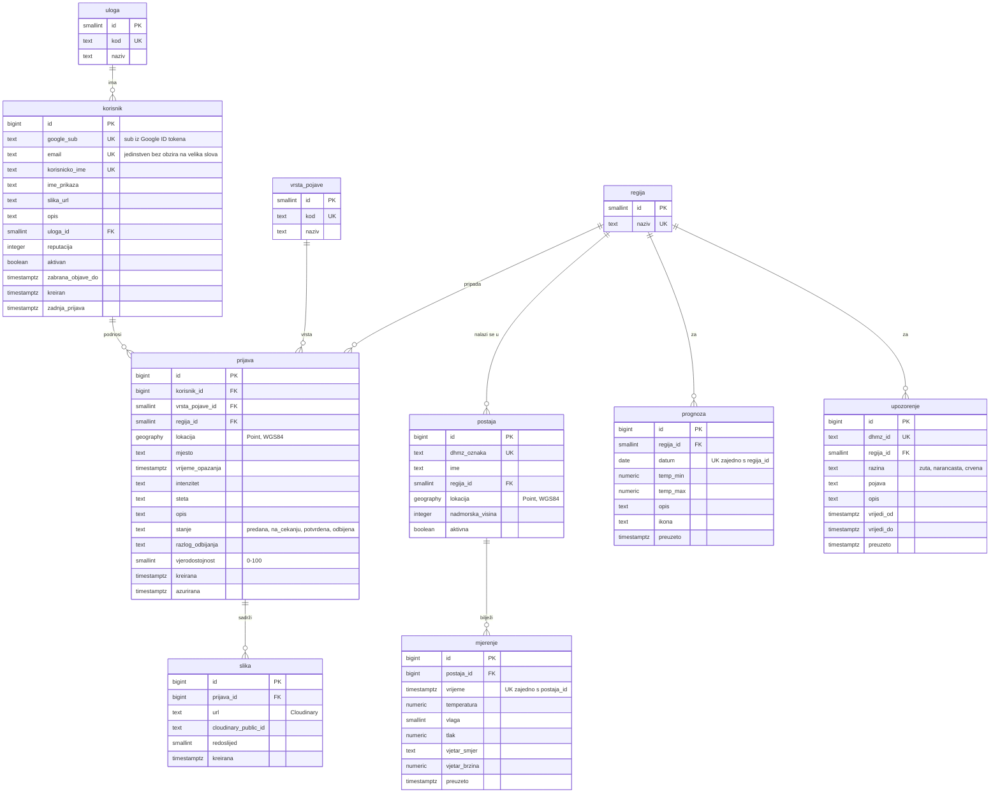

# Model podataka

Baza je **PostgreSQL** s ekstenzijom **PostGIS** za prostorne podatke. Shema je u
[`database/migrations/`](../database/migrations/), a ovaj dokument opisuje stanje
nakon migracije `pocetna-shema` (prva predaja).

Opseg prve predaje pokriva FZ-01 do FZ-04 i FZ-06: korisnike i uloge, podatke DHMZ-a
i prijave nevremena. Tablice za potvrde, komentare, događaje, praćenja i obavijesti
(FZ-07 do FZ-14) dodaju se u idućim migracijama.

## ER dijagram

## Tablice

| Tablica | Namjena | Zahtjevi |
|---|---|---|
| `uloga` | Šifrarnik uloga: korisnik, pouzdani motritelj, moderator, meteorolog, administrator | FZ-12, FZ-15 |
| `regija` | Regije Hrvatske; određuju upozorenja, prognoze i nadležnost moderatora | FZ-04, FZ-11 |
| `vrsta_pojave` | Šifrarnik vrsta nevremena (tuča, olujni vjetar, jaka kiša...) | FZ-04, FZ-06 |
| `korisnik` | Korisnici prijavljeni preko Googlea, s ulogom, reputacijom i zabranama | FZ-02, FZ-05, FZ-08 |
| `postaja` | DHMZ mjerne postaje s lokacijom | FZ-01, FZ-03 |
| `mjerenje` | Mjerenja s postaja, uvoze se svakih 30 min | FZ-01, FZ-03 |
| `prognoza` | Prognoza po regiji i danu | FZ-01, FZ-03 |
| `upozorenje` | DHMZ upozorenja po regiji, s razinom i trajanjem | FZ-01, FZ-03 |
| `prijava` | Prijave nevremena s lokacijom, stanjem i ocjenom vjerodostojnosti | FZ-04, FZ-06, FZ-11 |
| `slika` | Poveznice na fotografije prijave (slike su na Cloudinaryju, ne u bazi) | FZ-06 |

Pogled `zadnje_mjerenje` vraća posljednje mjerenje za svaku aktivnu postaju (sloj postaja na karti).

## Važnije odluke

- **Lokacije** su tipa `geography(Point, 4326)` (WGS84, kao GPS i Leaflet) s GiST
  indeksom. Udaljenosti se računaju u metrima, a upiti „najbliža postaja“ (`<->`) i
  „prijave u krugu“ (`ST_DWithin`) koriste indeks.
- **Stanje prijave** i **razina upozorenja** ograničeni su `CHECK` ograničenjem, a vrste
  pojava i uloge su šifrarnici, pa se nova vrijednost dodaje bez promjene sheme.
- **Uvoz DHMZ podataka je idempotentan**: mjerenje je jedinstveno po (postaja, vrijeme),
  prognoza po (regija, datum), upozorenje po `dhmz_id`, pa ponovljeni uvoz ne stvara duplikate.
- **Regija prijave** postavlja se prema najbližoj mjernoj postaji. Po njoj se prijava
  dodjeljuje moderatoru.
- **Prijava pouzdanog motritelja** sprema se odmah kao `potvrdena` (ne prolazi moderaciju).
- **Korisnik** ima jednu ulogu. E-pošta je jedinstvena bez obzira na velika i mala slova.
  Testni korisnici nemaju `google_sub` i povezuju se s Google računom po e-pošti pri prvoj prijavi.
- **Slike** se ne spremaju u bazu; spremaju se samo URL i Cloudinary `public_id` (za brisanje).
